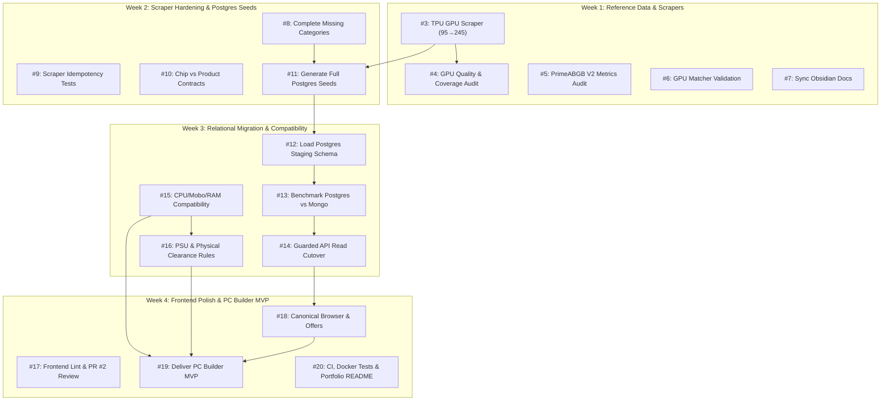

# Engineering Roadmap — 30-Day Sprint Plan

This document organizes the 30-day development roadmap for **Loop PC Builder**.

> [!IMPORTANT] Authority & Task Tracking
> **GitHub Issues (#3–#20) and GitHub Projects are the authoritative source for task assignment, lifecycle states (Open, In Progress, Closed), and sprint tracking.**
> This roadmap documents sprint sequencing, strategic priorities, and technical dependencies. It does not replace or duplicate GitHub issue states.

---

## 🧭 Milestone Overview & Critical Path

---

## 📅 Sprint Breakdown

### Sprint Week 1: Reference Data Completeness & Scraper Reliability
*Focus: Complete reference datasets and ensure scraper reliability before introducing new application features.*

| Issue | Title | Priority | Estimate | Dependencies & Notes |
| :---: | :--- | :---: | :---: | :--- |
| [#3](https://github.com/Agam-Ramteke/loop-pc-builder/issues/3) | `[W1] Complete TechPowerUp GPU reference scraping (95/245 → 245/245)` | `P0` | 6–10 h | **Highest priority**. Resumes `TechPowerUp_GPUs/scraper.py` for remaining 150 GPUs. |
| [#4](https://github.com/Agam-Ramteke/loop-pc-builder/issues/4) | `[W1] Add GPU reference scrape coverage and quality audit` | `P0` | 3–5 h | Depends on #3. Reconciles extracted spec fields and board variants. |
| [#5](https://github.com/Agam-Ramteke/loop-pc-builder/issues/5) | `[W1] Audit PrimeABGB V2 delta scraper metrics and failure recovery` | `P1` | 4–6 h | Audits `Bulk_data.py` concurrency, retry backoffs, and error telemetry. |
| [#6](https://github.com/Agam-Ramteke/loop-pc-builder/issues/6) | `[W1] Validate GPU canonical matcher coverage including Intel Arc` | `P1` | 4–5 h | Validates 46-test suite; verifies A-series & B-series Intel Arc rules. |
| [#7](https://github.com/Agam-Ramteke/loop-pc-builder/issues/7) | `[W1] Sync Obsidian documentation with current scraper architecture` | `P1` | 3–4 h | Vault bootstrap and reconciliation with working tree implementation. |

---

### Sprint Week 2: Scraper Fleet Hardening & Relational Seeds
*Focus: Expand catalog coverage to secondary hardware categories and generate verified PostgreSQL seeds.*

| Issue | Title | Priority | Estimate | Dependencies & Notes |
| :---: | :--- | :---: | :---: | :--- |
| [#8](https://github.com/Agam-Ramteke/loop-pc-builder/issues/8) | `[W2] Complete missing retailer component categories` | `P1` | 6–9 h | Triggers and validates Storage, SMPS, Cabinets, and Coolers imports. |
| [#9](https://github.com/Agam-Ramteke/loop-pc-builder/issues/9) | `[W2] Harden scraper regression tests and idempotent upserts` | `P2` | 4–6 h | Unit tests for upsert logic, duplicate handling, and offline fixtures. |
| [#10](https://github.com/Agam-Ramteke/loop-pc-builder/issues/10) | `[W2] Define canonical chip versus retailer-product data contracts` | `P2` | 4–6 h | Establishes Pydantic / TypeScript data contracts for dual-layer schema. |
| [#11](https://github.com/Agam-Ramteke/loop-pc-builder/issues/11) | `[W2] Generate and validate PostgreSQL GPU/CPU seed exports` | `P0` | 5–8 h | Depends on #3 & #8. Runs `export_postgres_seed.py` with 100% reference data. |

---

### Sprint Week 3: Relational Database Migration & Compatibility Rules
*Focus: Staging PostgreSQL, establishing query performance parity, and building the core compatibility engine.*

| Issue | Title | Priority | Estimate | Dependencies & Notes |
| :---: | :--- | :---: | :---: | :--- |
| [#12](https://github.com/Agam-Ramteke/loop-pc-builder/issues/12) | `[W3] Load PostgreSQL staging schema and validate data integrity` | `P0` | 4–6 h | Depends on #11. Applies `schema.sql` and loads seed JSONs via `load_postgres_seed.py`. |
| [#13](https://github.com/Agam-Ramteke/loop-pc-builder/issues/13) | `[W3] Benchmark PostgreSQL queries against current Mongo catalog API` | `P1` | 4–6 h | Depends on #12. Evaluates query latency, join overhead, and index performance. |
| [#14](https://github.com/Agam-Ramteke/loop-pc-builder/issues/14) | `[W3] Prepare guarded /api/components PostgreSQL read-path cutover` | `P0` | 6–9 h | Depends on #12 & #13. Implements feature-flagged DB adapter with safe fallback. |
| [#15](https://github.com/Agam-Ramteke/loop-pc-builder/issues/15) | `[W3] Implement CPU–motherboard and RAM compatibility rules` | `P0` | 6–8 h | Core deterministic rules for socket, chipset BIOS, and DDR generation. |
| [#16](https://github.com/Agam-Ramteke/loop-pc-builder/issues/16) | `[W3] Add PSU, case and GPU physical-fit compatibility warnings` | `P1` | 5–7 h | Depends on #15. Evaluates power budgets, card length, and cooler clearance. |

---

### Sprint Week 4: Application Polish, Offer Comparison, PC Builder MVP & CI
*Focus: Deliver the user-facing builder experience, multi-retailer offer view, and portfolio-ready documentation.*

| Issue | Title | Priority | Estimate | Dependencies & Notes |
| :---: | :--- | :---: | :---: | :--- |
| [#17](https://github.com/Agam-Ramteke/loop-pc-builder/issues/17) | `[W4] Resolve frontend lint/type warnings and review open API PR` | `P1` | 4–6 h | Reviews [PR #2](https://github.com/Agam-Ramteke/loop-pc-builder/pull/2) and fixes React 19 / Next 16 hook lint warnings. |
| [#18](https://github.com/Agam-Ramteke/loop-pc-builder/issues/18) | `[W4] Build canonical component browser with retailer offer comparison` | `P1` | 6–9 h | Depends on #14. Displays unified chip specs alongside competing retailer prices. |
| [#19](https://github.com/Agam-Ramteke/loop-pc-builder/issues/19) | `[W4] Deliver PC builder MVP with compatibility feedback and shareable builds` | `P1` | 9–14 h | Depends on #15, #16, #18. Interactive builder with real-time feedback & URL sharing. |
| [#20](https://github.com/Agam-Ramteke/loop-pc-builder/issues/20) | `[W4] Add CI, Docker integration smoke tests and portfolio-ready README` | `P1` | 5–8 h | GitHub Actions workflow, smoke tests, and architecture-backed README. |

---

## 🔗 Related Documentation
- [[00-Dashboard|Vault Dashboard]]
- [[Architecture/System-Overview|System Overview]]
- [[Decisions/ADR-001-Two-Layer-Relational-Schema|ADR-001: Two-Layer Relational Schema]]
